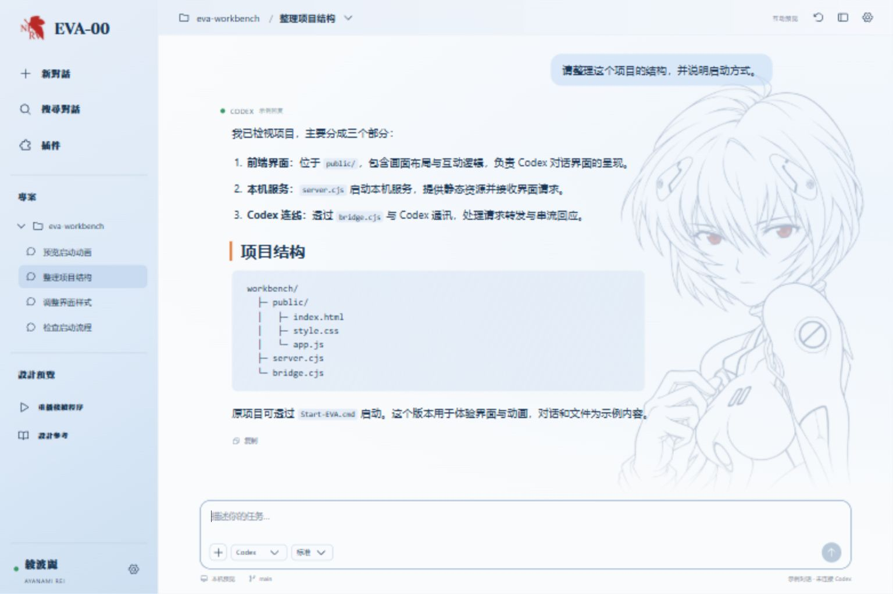

# EVA-00 Workbench

> 从红黑警报、LCL 注入到 400% 同步与驾驶员确认，为 AI 工作台设计一段可参与、可跳过、可重播的进入体验。

EVA-00 Workbench 是以《新世纪福音战士》零号机与绫波丽为主题的交互设计与前端实践。项目将影视中的警报仪表、机械空间、身份识别与镜头节奏转化为浏览器中的实时界面，并将这套视觉语言延伸到日常工作区。

**项目关键词：** AI 工作台体验 · 交互设计 · Canvas 动画 · React · 主题适配

**版本范围（2026-11-13）：** 当前公开 `main` 分支提供可运行的前端预览，对话和文件使用示例数据，未连接真实 Codex。另有已进行本地验收的 DeepSeek Harness（DSH）插件版本，源码与安装包尚未包含在公开 `main` 中，详见下方“本地插件进展”。

[本地运行](#本地运行) · [体验流程](#体验流程) · [交互与工程细节](#交互与工程细节) · [本地插件进展](#本地插件进展) · [设计与验收记录](preview/design-qa.md)

## 视觉预览



*工作台早期迭代截图，用于展示蓝白配色、字体层级与人物背景；当前开场已更新为红黑警报仪表，驾驶员确认区也已加入证件卡。*

## 设计目标

这个项目探索的是：如何让 AI 工具具有鲜明的个人风格，同时保留日常工作的可读性与操作效率。

- **进入工作时有完整体验。** 从警报、唤醒到同步与身份确认，形成连续的视觉叙事。
- **演出由用户控制。** 主动启动、关键节点确认、随时用 Esc 跳过，并可选择下次直接进入工作台。
- **工作区适合持续阅读。** 将强烈的视觉表现集中在开场，正文、代码和输入区域保持清晰。

## 体验流程

| 阶段 | 画面与交互 | 设计重点 |
| --- | --- | --- |
| 红黑警报 | 具有透视关系的蜂巢仪表、七段数字时钟、信号监视与驾驶员信息；等待点击或键盘启动 | 用仪表构图建立场景，时钟读取设备本地时间 |
| 系统唤醒 | 居中的 NERV 标识与“系統喚醒”标题 | 通过明确的构图切换引导注意力 |
| LCL 注入与排出 | 橙色液体覆盖蓝色边轨，再逐步露出机械空间 | 使用层次遮罩、液面运动与空间透视表现注入过程 |
| 同步率增长 | 刻度盘、七段数字与环形进度共同增长至 400% | 数字与圆环在阈值处同时变红 |
| 驾驶员确认 | 展示绫波丽证件卡、机体与身份信息，并停留等待确认 | 让用户参与关键节点；400% 是动画设定，不代表模型计算进度 |
| 进入工作台 | 确认后完成场景收束，显示可操作的会话界面 | 将开场演出与后续使用连接起来 |

默认采用较慢节奏并保持静音。用户可重播完整流程，或保存“下次直接进入工作台”的偏好。

## 视觉系统

**色彩与空间。** 红黑警报强调开场的紧张感，蓝白工作区承载长时间阅读；橙色 LCL 与红色同步状态作为局部强调。机械井道、细刻度和警示边轨共同建立零号机的场景特征。

**字体与信息层级。** 固定展示标题使用 Matisse 字体，通过字面压缩、紧凑间距和中英文比例调整形成电影标题感。动态对话与说明使用易读的无衬线字体，代码保留等宽字体，避免装饰字形影响正文阅读。

**人物与身份。** 绫波丽线稿以低对比背景呈现，浓度可调；驾驶员证件将头像、姓名、机体、身份编号和认证状态组织为独立的信息组件。角色图像、字体与上游动画来源见文末说明。

## 预览版可以操作什么

- 新建、切换和搜索当前页面内的会话。
- 输入消息、接收延时示例回复、停止示例回复、复制内容。
- 选择并预览图片附件；不向模型发送图片。
- 展开示例文件面板、查看和复制文件内容；Diff 页为状态占位。
- 调整背景线稿浓度、播放节奏和下次是否直接进入工作台。
- 重播开场，使用鼠标或键盘启动、确认与跳过。

偏好保存在浏览器本地。会话是预览状态，不应视为持久化聊天服务；文件面板也不会访问或修改本机项目。

## 交互与工程细节

| 问题 | 实现与取舍 |
| --- | --- |
| 多阶段动画如何保持连续 | Canvas 场景由统一时钟和阶段参数驱动，React 管理启动、确认和离场状态 |
| 警报仪表如何适应不同桌面尺寸 | SVG 组织仪表几何与透视布局，按视口保持面板比例 |
| 400% 如何稳定等待用户 | 到达阈值后锁定场景时间，确认后再继续推进 |
| 切后台后如何避免突然快进 | 页面隐藏时暂停场景推进，返回前台时重置帧时间基准 |
| 图片或字体加载失败怎么办 | 提供可读回退，资源等待有上限；跳过操作不依赖素材加载完成 |
| 如何避免重复播放残留 | 组件卸载时清理动画帧、定时器、资源回调与事件监听 |
| 如何兼顾键盘使用 | 保留原生按钮语义、Enter / Space 启动、确认按钮焦点与 Esc 跳过 |
| 如何检查视觉修改 | 结合关键帧截图、真实时间线播放、尺寸矩阵和浏览器测试 |

减少动态效果偏好已用于警报开场及其退场；后续 LCL 演出尚未完整改造为低动态版本，不把它描述为全流程无障碍验收完成。

## 本地插件进展

**以下为本地扩展版本的开发进展说明，不是当前公开分支的安装承诺。**

项目已进一步适配为 `dsh-skin-eva-00` 插件，目标为 **DSH 0.2.2-rc.1 / Windows Web profile**。本地版本复用完整开场组件，结束后交接到宿主真实会话，提供 EVA-00 浅色与 EVA-NERV 深色主题。

这一阶段重点解决演出与真实工作的共存：

- 仅选择 EVA 主题时启用装饰，切回官方主题时撤销插件样式与入口。
- 人物限制在会话背景，原生消息、代码、Diff 与输入框保留宿主字体。
- 手动重播前检查任务、待处理交互、弹窗、文字及附件草稿、输入法与编辑状态；无法确认关键状态时不播放。
- 演出期间出现需处理的宿主活动时交还控制，并恢复背景交互与焦点。
- 提供安装包、版本化资源路径、文件 SHA256 清单与卸载回退流程。

本地 2026-11-08 验收记录包含真实模型请求与停止、浅深主题长正文和代码显示、正式包安装、完整演出与卸载恢复。**当前未启用自动首播**：缺少已核实的完整宿主空闲接口，因此仅支持条件满足时手动重播。实际权限审批流程、原生 Diff 流程、其他宿主版本及 Electron desktop profile 尚未完成验收；主题刷新后也可能需要重选。

插件源码、安装包与完整宿主验收材料尚未随公开分支交付。当前克隆仓库后，请使用下方前端预览入口。

## 技术实现与目录

| 技术 | 用途 |
| --- | --- |
| React 19 | 会话预览、偏好、启动状态与确认组件 |
| Vite 6 | 本地开发与构建 |
| Canvas 2D | LCL、机械空间、同步环与连续场景 |
| SVG / CSS | 警报仪表、证件布局、字体与工作台样式 |
| 浏览器存储 | 保存视觉与播放偏好 |
| Node.js 测试与浏览器脚本 | 交互回归、布局检查与关键帧采集 |

```text
preview/
├── src/App.jsx                会话、文件与偏好预览
├── src/BootSequence.jsx       启动时钟、资源就绪与确认状态
├── src/boot/                  警报、LCL、同步环、证件与场景模块
├── public/assets/             字体、标识与角色素材
├── scripts/                   构建辅助、字形检查与视觉采集
├── tests/                     浏览器交互及部署适配测试
├── design-qa.md               设计迭代与验收记录
└── THIRD_PARTY_NOTICES.md      上游动画代码署名与许可
docs/superpowers/              设计规格与实施记录
```

本地开发环境中的 `tooling/` 不属于应用源码，也不需要随作品发布。

## 本地运行

准备与 Vite 6 兼容的 Node.js 和 npm，在仓库根目录执行：

```bash
git clone https://github.com/spike5321/eva-work.git
cd eva-work/preview
npm ci
npm run dev
```

打开终端显示的本地地址即可体验。预览不需要模型 API Key。

构建与部署适配检查：

```bash
npm run build
npm run test:sites
```

浏览器回归入口为 `preview/tests/emergency-browser.test.mjs`；环境与采集方式见测试代码和验收文档。构建成功不等同于已部署公网。

## 验证记录与当前边界

公开的[设计与验收记录](preview/design-qa.md)记录了构建、键盘操作、正常与慢速时间线、资源异常、后台暂停、重播和多种桌面尺寸的检查。它们是对应迭代时的历史结果，复现时应以当前环境实际输出为准。

- 公开预览使用模拟回复，不具备真实 Codex 调用、文件编辑或账号连接能力。
- 当前主要验收平台为桌面 Edge / Chromium；已有窄屏适配不等同于最新完整流程通过移动端验收。
- 原始参考项目的 WebGL 后处理与真实窗口快照交接没有包含在本预览中。
- 本地 DSH 插件的能力与公开预览不同，请按上方版本范围理解。

## 项目贡献与参考来源

本项目的工作集中于零号机视觉改造、红黑警报仪表、字体与布局调整、驾驶员证件、连续交互编排、React 集成与浏览器验证，并在本地继续探索真实 AI 工作台的主题与生命周期适配。

启动动画模块改编自 [Iris-change/eva-codex-workbench](https://github.com/Iris-change/eva-codex-workbench)，保留其 MIT 署名。其他设计参考包括 [dragon-codex-boot](https://github.com/yushua0808-cpu/dragon-codex-boot) 的交接概念，以及 [nerv-ui](https://github.com/TheGreatGildo/nerv-ui) 的标题与状态表达。

上游代码许可见 [THIRD_PARTY_NOTICES.md](preview/THIRD_PARTY_NOTICES.md)。EVA 角色、标识及字体各有其权利归属；代码许可不自动授予这些素材的再分发权。本项目按个人主题与交互实践展示，不代表相关作品或 AI 产品的官方项目。
